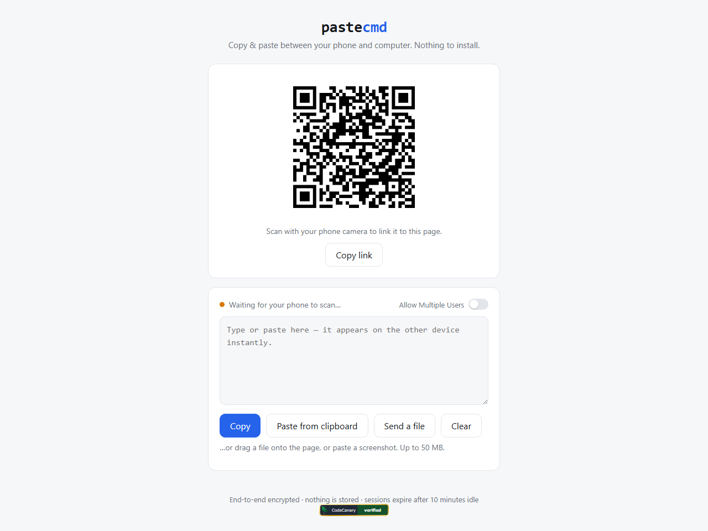
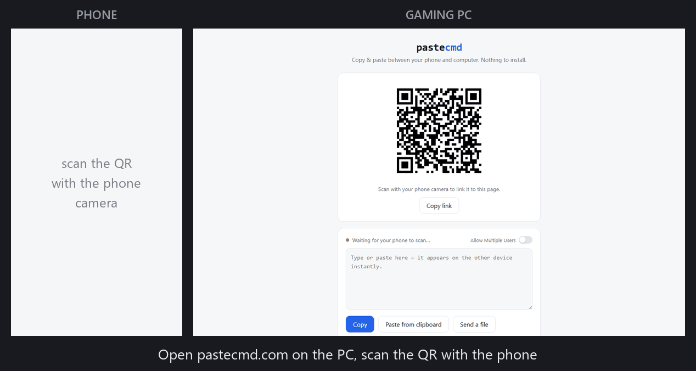

# pastecmd

Copy & paste between your phone and computer. No install, no account.

Open the site on your computer, scan the QR code with your phone, and anything
typed or pasted on one device appears on the other instantly. Files up to
50 MB (photos, PDFs, screenshots) can be sent too — drag one onto the page,
use the "Send a file" button, or paste a screenshot directly.

[](https://pastecmd.com)

Live at [pastecmd.com](https://pastecmd.com). Sibling project of
[passburn.com](https://github.com/HotStartLabs/passburn).



## How it works

- One Cloudflare Worker serves the static page and relays WebSocket messages
  through a Durable Object (one per session).
- Pairing needs only a six-character code (e.g. `K7XQ2M`), or the QR that
  carries it. Both devices derive the same rendezvous ID from the code with
  PBKDF2, so the code alone finds the session — there is no link to copy, and
  the code works from any network. Only that derived, random-looking ID ever
  reaches the server.
- The AES-256 content key is generated by the host and handed to the joining
  device through an ephemeral ECDH (P-256) exchange. Each side proves it knows
  the code with an HMAC before the key is wrapped, so the key is never on the
  wire and a relay cannot decrypt what it forwards. All clipboard content is
  AES-GCM encrypted in the browser; the server only ever relays ciphertext.
- Files travel through the same relay, sliced into 256 KB chunks that are each
  encrypted and sent as binary WebSocket frames (Cloudflare caps a single
  message at 1 MB). Filenames are encrypted too. Nothing touches disk.

## Pairing

Open the page on one device: it shows a QR and a six-character code. On the
other device, scan the QR or open the page and type the code into "Enter
code". Either path works from any network — same Wi-Fi, different networks,
mobile data — because the code is what locates the session, not a link.

The code is live only while the host page has the session open. Codes are
random per session and the character set drops look-alikes (no I, L, O, 0 or
1), so `K7XQ2M`-style codes are easy to read out over a call.

## Security model

- Sessions are capped at 2 concurrent devices by default; the host's "Allow
  Multiple Users" lever raises the cap to 8 (and regenerates the session, since
  the server locks the cap on the creator's first connection — later joiners
  can't widen it). A third device is turned away with a "session full" screen,
  which doubles as an alarm if someone else learned the code.
- Only the host can create a session. A joining device that arrives before the
  host keeps retrying briefly, then reports that no device answered the code.
- The joining device never receives the key from the server. It claims the
  room with `pair-join` (ephemeral ECDH public key + nonce + HMAC keyed by the
  code); the host verifies that HMAC before wrapping the content key, and the
  joiner verifies the host's HMAC before accepting it. A party that knows only
  the rendezvous ID (the relay included) fails the check and gets nothing.
- The key is wrapped with a key derived from the ECDH secret (HKDF), so even
  someone who later learns the code cannot unwrap a recorded handoff. The
  rendezvous ID is PBKDF2-derived so the ~2^30 code space cannot be enumerated
  instantly from an observed ID.
- A device that drops and reconnects (network switch, reload) reclaims its
  own slot with a per-tab random token, so a dead connection still holding
  the slot doesn't trigger a false "session full". Only that tab has the
  token, so nobody else holding the code can use it to push a device out.
- A reloaded tab keeps its room, code and key in `sessionStorage` (per-tab)
  and rejoins without retyping the code. Nothing is written to the URL.
- Every ciphertext is bound to its context with AES-GCM AAD
  ("clip"+sender+seq, "file-start"+sender+seq+fileId, "chunk"+fileId+index).
  The relay cannot replay a message as a different type, re-deliver an old
  clip or file, or reorder file chunks without it being rejected.
- Received files are also checked against what a peer (who holds the key)
  could send: metadata is validated, every chunk must be exactly its
  expected size, and in-flight transfers are capped. Downloads are served as
  `application/octet-stream` regardless of the sender's declared type.
- Server control messages (peer count) are NUL-prefixed and the relay refuses
  to forward client strings with that prefix — a device in the session cannot
  forge the peer count to hide its presence. The device counter in the UI is
  the intruder alarm: if it says 3 and you have 2 devices, start a new session.
- The WebSocket endpoint rejects browser connections from foreign origins.
- AES-256-GCM keys (post-quantum resistant by construction — pure symmetric
  crypto retains 128-bit margin against Grover).
- Strict security headers on every response: CSP (no inline script, no
  external sources) with Trusted Types enforcement (DOM-XSS sinks throw at
  runtime, and no policy may be created to bypass that), HSTS (2 years, preload), full cross-origin isolation
  (COOP/COEP/CORP), X-Frame-Options DENY, no-referrer, nosniff.
- No cookies, no analytics, no external requests, no server-side storage of
  content — the only server state is a session-expiry alarm.
- Residual/accepted: anyone who learns the code during the session window
  holds the key — that is the trust model, so guard the screen like a shared
  secret. The code is short (30 bits), so the design leans on the ECDH
  handoff and the session TTL rather than on code entropy; guessing a code
  means finding a live room before it expires, and each attempt is a new
  connection that the per-IP WAF rule rate limits. Cloudflare sees connection
  metadata (IPs, timing, ciphertext sizes) but no plaintext.
  A device that has just loaded has no message history, so
  the relay could feed it a stale clip as the first one it sees.
- Sessions expire after 10 minutes idle; nothing is ever stored.

## Local development

```
npm install
cp .dev.vars.example .dev.vars
npm run dev        # http://localhost:8787
```

To test, open the page, then either scan the QR or pick "Enter code" in a
second tab and type the six characters — the two will sync.

`npm test` runs the integration tests. They start their own `wrangler dev`,
drive two copies of the real client (host and joiner, with a stubbed DOM),
and use raw sockets to act as a malicious relay and a malicious peer that
holds the key: replays, duplicate chunks, forged metadata, oversized
messages.

## Deploying

1. `npx wrangler login` — sign in to your (free) Cloudflare account.
2. `npm run deploy` — the site goes live on the custom domains in `routes`.

If you're deploying your own copy, edit `wrangler.jsonc` first:

- Set `CANONICAL_HOST` to your hostname. The worker redirects every other
  host to it, and it's the only origin allowed in the CSP `connect-src` and
  on the WebSocket relay.
- Replace the `routes` (they bind the worker to the pastecmd.com domains).
  To run on `workers.dev` instead, remove `routes`, set `"workers_dev": true`,
  and set `CANONICAL_HOST` to `pastecmd.<your-subdomain>.workers.dev`.

### Connecting the domains

1. In the Cloudflare dashboard, **Add a site** for `pastecmd.com` (free plan),
   then repeat for `pastecommand.com`. Cloudflare will show two nameservers
   for each.
2. At your domain registrar, replace each domain's nameservers with the ones
   Cloudflare gave you. (Propagation can take a few hours.)
3. In the dashboard under **Workers & Pages → pastecmd → Settings → Domains &
   Routes**, add custom domains: `pastecmd.com` and `pastecommand.com`.

The worker itself 301-redirects any `pastecommand.com` request to
`pastecmd.com`, so both names work and search engines see one canonical site.

### Rate limiting the relay

Each new session ID starts a Durable Object, which means a storage write and
an alarm, so `/ws/*` is rate limited per IP with a WAF rule on the
`pastecmd.com` zone. `pastecommand.com` doesn't need one: it redirects before
anything reaches a Durable Object. Create the rule under
[Security rules](https://dash.cloudflare.com/?to=/:account/:zone/security/security-rules)
→ **Create rule** → **Rate limiting rules**:

- **If incoming requests match:** URI Path *starts with* `/ws/`
  (expression `starts_with(http.request.uri.path, "/ws/")`)
- **With the same characteristics:** IP
- **When rate exceeds:** 20 requests per 10 seconds
- **Then take action:** Block, for 10 seconds

Those are the Free plan's only options (one rule, IP only, 10 s period,
10 s timeout). 20 per 10 s leaves headroom for a host and a phone sharing one
NAT address while both reconnect with backoff.

## Costs

Free tier covers ~100K requests/day (thousands of sessions). If it outgrows
that, the $5/month Workers Paid plan covers ~10M requests.

## License

[MIT](LICENSE)
